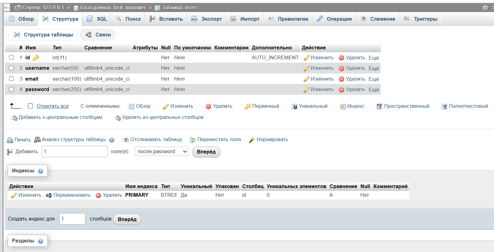
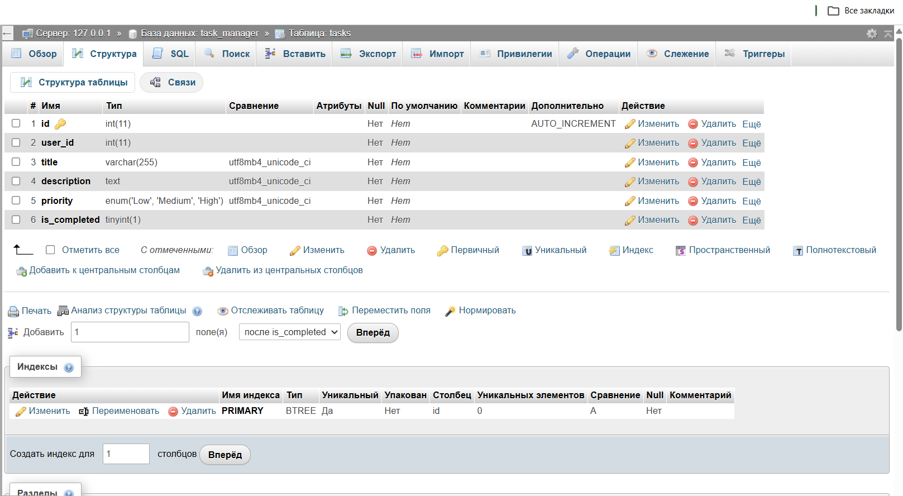
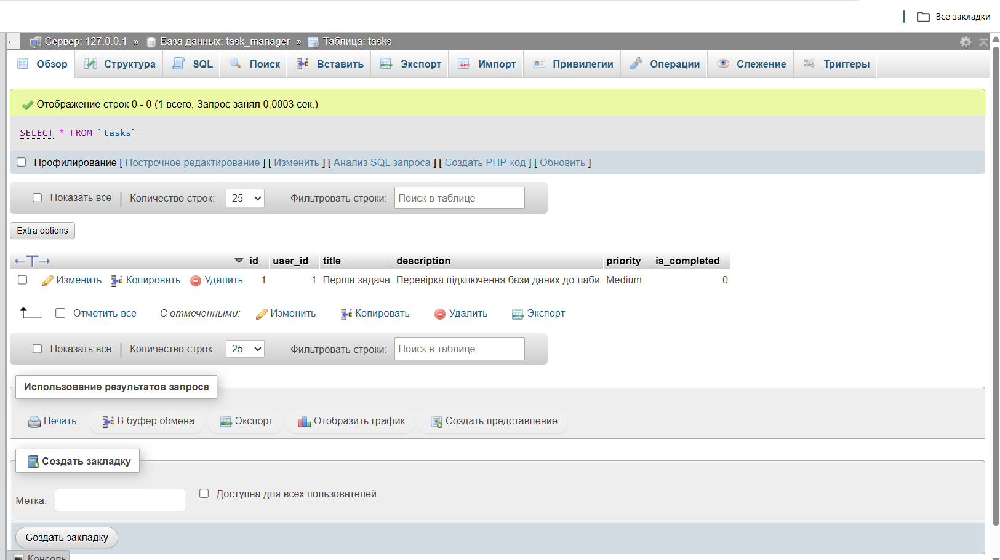
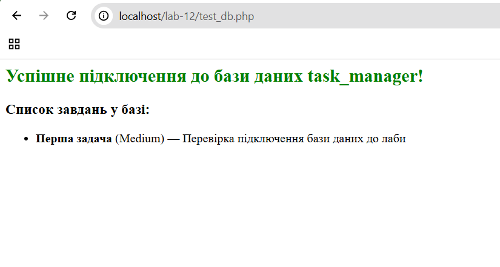

# Звіт до Лабораторної роботи №12

## 1. Мета роботи
Створення та налаштування реляційної бази даних `task_manager` у СУБД MySQL (через XAMPP), створення таблиць `users` і `tasks`, а також перевірка підключення за допомогою PHP (PDO).

## 2. Хід виконання роботи

### Крок 1. Створення бази даних та таблиці `users`
Створено базу даних `task_manager` (кодування `utf8mb4_unicode_ci`) та таблицю `users`.
* **Скріншот структури таблиці `users`:**
  

### Крок 2. Створення таблиці `tasks` та зв'язки
Створено таблицю `tasks` із полями `id`, `user_id`, `title`, `description`, `priority` (ENUM), `is_completed`.
* **Скріншот структури таблиці `tasks`:**
  

### Крок 3. Додавання тестових даних
Додано тестового користувача та задачу у таблицю `tasks`.
* **Скріншот даних у таблиці:**
  

### Крок 4. Перевірка підключення через PHP (PDO)
Створено скрипт `test_db.php` для перевірки підключення та виведення даних.
* **Скріншот результату в браузере:**
  

  ## Контрольні запитання та відповіді

**1. Що таке СКБД (DBMS)? У чому полягає різниця між безпосередньо сервером бази даних (MySQL) та веб-інтерфейсом phpMyAdmin?**
* **СКБД (Система керування базами даних)** — це програмне забезпечення для створення, збереження, модифікації та керування даними в базах даних.
* **MySQL (сервер БД)** — це рушій, який обробляє SQL-запити, зберігає файли даних на диску та керує доступом. 
* **phpMyAdmin** — це графічний веб-інтерфейс (панель керування через браузер), який спрощує роботу з MySQL, перетворюючи команди на зручні елементи керування.

**2. Для чого використовується атрибут Auto Increment (A_I), який призначається первинному полю id?**
Атрибут `Auto Increment` автоматично генерує унікальне порядкове числове значення (`1, 2, 3...`) для кожного нового рядка, що додається в таблицю, позбавляючи розробника необхідності вручну контролювати унікальність ідентифікаторів.

**3. Що таке PRIMARY KEY (Первинний ключ) і для чого він критично потрібен у кожній реляційній таблиці?**
`PRIMARY KEY` — це стовпець або комбінація стовпців, значення яких унікально ідентифікують кожен рядок таблиці (не може повторюватися і не може бути `NULL`). Він необхідний для забезпечення цілісності даних, швидкого пошуку записів та організації зв'язків між таблицями.

**4. Назвіть щонайменше 2 текстові типи даних у MySQL (VARCHAR, TEXT) та поясніть різницю між ними.**
* **`VARCHAR(n)`** — рядок змінної довжини до вказаного ліміту `n`, який підходить для коротких полів та може індексуватися.
* **`TEXT`** — тип для зберігання великих обсягів текстових даних без фіксованого ліміту в оголошенні.

**5. Чому для збереження паролів виділено стовпець VARCHAR(255), а не поле меншої фіксованої довжини?**
Сучасні криптографічні хеш-функції для безпечного збереження паролів (наприклад, `password_hash()` у PHP через алгоритми типу `bcrypt` або `Argon2`) генерують рядки фіксованої довжини до 255 символів. Формат `VARCHAR(255)` є стандартом із необхідним запасом.

**6. Що таке інтерфейс PDO (PHP Data Objects) у PHP та які суттєві переваги він надає порівняно із застарілим набором функцій mysql_*?**
* **`PDO`** — це універсальний об'єктно-орієнтований інтерфейс для роботи з базами даних у PHP.
* **Переваги:** підтримка підготовлених виразів (*Prepared Statements*) для захисту від SQL-ін'єкцій; можливість працювати з різними СУБД; зручна обробка помилок через винятки (`try...catch`).

**7. Що таке рядок DSN (Data Source Name) та які обов’язкові компоненти входять до його складу під час з’єднання з MySQL?**
**DSN** — це рядок конфігурації для драйвера бази даних. Для MySQL до його обов'язкових компонентів входять: драйвер (`mysql`), назва хоста (`host=...`), назва бази даних (`dbname=...`) та кодування (`charset=...`).

**8. Чому операцію встановлення з’єднання з базою даних через PDO необхідно огортати в блок try...catch (PDOException)?**
У разі помилки підключення PDO викидає виняток (`PDOException`). Якщо не огорнути код у `try...catch`, PHP зупинить виконання скрипта і виведе на екран системну помилку з конфіденційними даними (логіном і хостом), що створює вразливість безпеки. Блок `catch` дозволяє безпечно перехопити виняток.